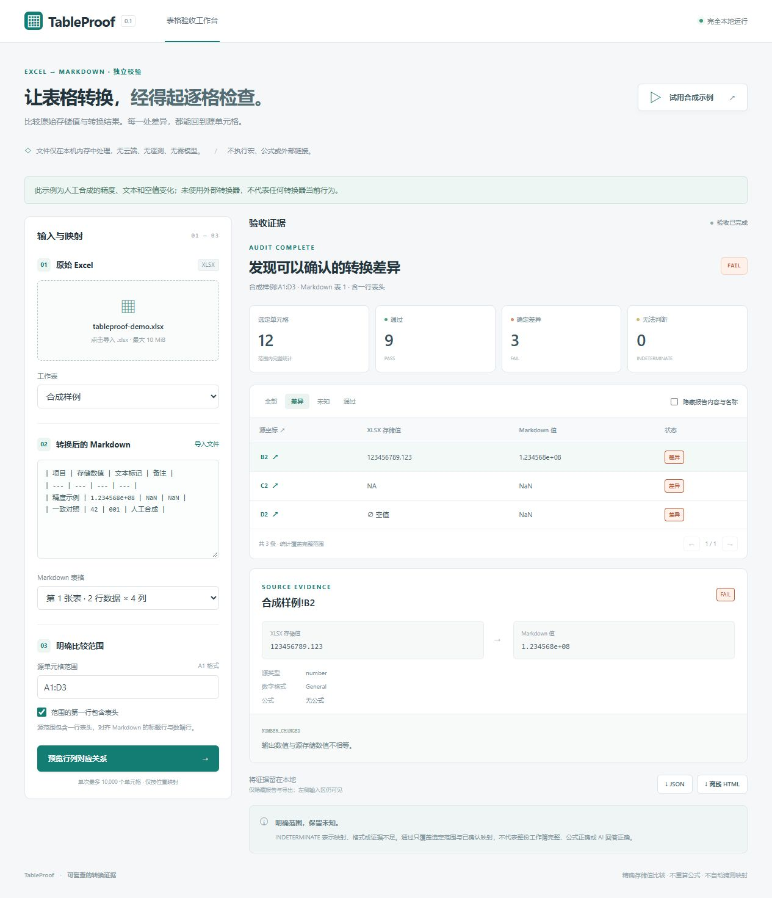

# TableProof

[English](README.md) | 中文

[安装](#安装) · [快速体验](#快速体验) · [命令与结果](#命令与结果) · [验证与接口](docs/validation.md) · [贡献指南](CONTRIBUTING.md)

**对照原始 XLSX 与转换后的 Markdown，在本地逐格检查数据变化，查看确定差异及对应的源单元格证据。**

**English:** Compare an original XLSX workbook with converted Markdown, identify confirmed differences, and inspect their source-cell evidence—all locally.

TableProof 接受原始 XLSX 和已经转换的 Markdown，独立读取源单元格，在你明确指定的范围内进行位置比较。例如，文本 `00123` 变成 `123`、数值 `123456789.123` 变成 `1.234568e+08`、文本 `NA` 变成 `NaN`，报告会指出对应的源坐标和判断依据。

通过 CLI 或本地网页预览选定单元格与 Markdown 表格的映射，并将检查结果导出为 JSON 或 HTML。



## 安装

需要 Python 3.10 或更新版本。在项目目录内执行：

```bash
git clone https://github.com/cloudwallker/TableProof.git
cd TableProof
python -m venv .venv
# macOS / Linux
source .venv/bin/activate
# Windows PowerShell
.venv\Scripts\Activate.ps1
python -m pip install -e .
```

这里只需运行与你的系统对应的激活命令。未激活环境时，也可用 `.venv/bin/python` 或 `.venv\Scripts\python.exe` 代替 `python`。代码尚未发布到 PyPI；请从本地项目目录安装，避免安装同名包。

## 快速体验

```bash
tableproof inspect examples/synthetic.xlsx
tableproof check examples/synthetic.xlsx --markdown examples/correct.md --sheet Demo --range A1:D4
tableproof check examples/synthetic.xlsx --markdown examples/lossy.md --sheet Demo --range A1:D4 --html report.html --json report.json
```

第一份 Markdown 应为 `PASS`，第二份应为 `FAIL`。这些文件是**人工制作的合成对照**，没有经过真实 MarkItDown 转换，不能用于声称某个转换器版本存在缺陷。详细数据与期望见 [examples/README.md](examples/README.md)。

启动本地界面：

```bash
tableproof serve --open
# 也可指定端口并自行打开 http://127.0.0.1:9000
tableproof serve --port 9000
```

服务只监听 `127.0.0.1`。导入文件、选择工作表和矩形范围、选择 Markdown 表后，先检查映射预览再确认比较。默认不上传文件、不调用模型、不记录遥测；工作簿公式、宏及外部链接不会执行。

Windows 用户完成环境安装后，也可双击项目根目录的 `Start-TableProof.cmd` 启动界面。

## 命令与结果

| 命令 | 用途 |
| --- | --- |
| `inspect FILE` | 输出工作表及范围信息，不输出单元格内容 |
| `check FILE --markdown FILE --sheet NAME --range A1:C3` | 检查一个明确映射的范围 |
| `serve [--port 8765] [--open]` | 启动本地界面；仅 `--open` 打开浏览器 |
| `convert FILE --output converted.md` | 可选调用本机 MarkItDown，生成 Markdown 与转换元数据 |

`check` 默认把选定 XLSX 范围的第一行与 Markdown 表头对齐；用 `--no-header` 时，选区全部行只与 Markdown 数据行比较，忽略 Markdown 表头。`--table 2` 选择第二张 Markdown 表，外部编号从 1 开始，JSON 内部 `table_index` 从 0 开始。工具不会发现尺寸相同的行列重排；映射由使用者确认。

```bash
tableproof check source.xlsx --markdown converted.md --sheet Sheet1 --range B2:D20 --table 2 --no-header --json -
tableproof check source.xlsx --markdown converted.md --sheet Sheet1 --range A1:C3 --html shared.html --json shared.json --redact
```

`--json -` 将 JSON 写到标准输出，摘要写到标准错误，便于管道处理。`--json PATH` 与 `--html PATH` 保存文件；已有输出文件会被替换，不能与输入文件相同。`--redact` 隐藏导出报告中的内容及可能含内容的说明，保留规则、坐标与统计。完整报告可能包含业务数据，应先检查再分享。

| 退出码 | 状态 | 含义 |
| --- | --- | --- |
| `0` | `PASS` | 全部选定单元格在支持规则下相符 |
| `1` | `FAIL` | 至少发现一个确定差异 |
| `2` | `INDETERMINATE` | 没有确定差异，但格式、结构或证据不足，无法全部验证 |
| `3` | 错误 | 输入、参数、文件访问、依赖或运行出错 |

有确定差异时整体为 `FAIL`，同时保留未验证项。尺寸不匹配时报告结构问题，停止逐格归因并返回 `INDETERMINATE`，防止把错位内容当成单元格差异。

## 可选转换

```bash
python -m pip install -e ".[convert]"
tableproof convert examples/synthetic.xlsx --output converted.md
```

结果附带 `converted.md.metadata.json`，记录 MarkItDown 版本、参数、输入与输出 SHA-256 以及时间，不包含文件绝对路径。转换器仅生成待验收文本，校验基准仍来自独立读取的 XLSX。此命令禁用 MarkItDown 第三方插件；缺少可选依赖时退出 `3`，不影响其他命令。

## 支持边界

`PASS` 表示选定且明确映射的单元格在支持规则下相符。整份工作簿的完整性、公式正确性和 AI 对内容的理解需要另行检查。

- 首版支持 XLSX、一张工作表、一个连续矩形范围和一张 GFM Markdown 表。CSV 输入不在首版范围内。
- 数值从 XLSX 原始 XML 读取，通过十进制比较；`1`、`1.0` 和 `1e0` 数值相等。无默认容差，不猜测千位符或区域格式。
- 文本编号保留前导零；文本 `NA`、`NULL`、`NaN` 与空值分开检查。Markdown 无法表达的源空字符串与缺失单元格区别不会判为已验证。
- 公式只比较文件保存的缓存结果，缓存新鲜度未知；无缓存返回无法判断，不重新计算公式。
- 存储值与显示格式分开。日期、百分比等缺少可靠解释的格式返回无法判断；`0.125` 与 `12.5%` 不直接判成损坏。
- 合并单元格、HTML 表格、嵌套表、不完整表格行等可识别的不支持结构会报告。只支持一行表头，用户需自行确认选区；普通文字组成的多层标题无法自动识别。位置映射不检查语义关系、单位、总计或行列重排。
- XLSX 输入最多 10 MiB、ZIP 展开最多 50 MiB，Markdown 最多 2 MiB；单次选区最多 10,000 个单元格。超限返回错误，不静默截短后宣布通过。
- 原工作簿保存之前已丢失的数据无法恢复。脱敏报告也不是任何隐私场景的自动发布许可。

## 开发与贡献

```bash
python -m pip install -e ".[dev]"
python -m pytest
python -m ruff check src tests scripts
python -m build
python scripts/generate_examples.py
```

欢迎贡献最小合成样例和预期结果。真实转换问题请附转换器名称、版本、参数及可公开复现的文件；不要提交个人数据、业务表格、日志凭据或密钥。见 [CONTRIBUTING.md](CONTRIBUTING.md)。

MIT License · Copyright (c) 2026 TableProof contributors.

## 界面体验

本地 Excel 到 Markdown 保真验收工具，提供易读的逐格证据、可用键盘操作的筛选以及适配窄屏的工作台和离线 HTML 报告。
